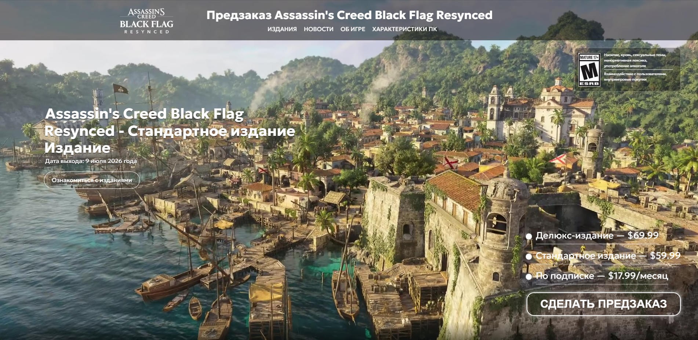

# 🎮 Website for a Class Project


[](https://developer.mozilla.org/en-US/docs/Web/HTML)
[](https://developer.mozilla.org/en-US/docs/Web/CSS)
[](https://developer.mozilla.org/en-US/docs/Web/JavaScript)
[](https://pages.github.com/)

**🔗 [Посмотреть живой сайт (Live Demo)](https://shaymorgan-dev.github.io/website-for-a-class-project/)**

---

## 📖 О проекте

Этот сайт является моим продуктом по курсу "Индивидуальный проект" на первом курсе IT-колледжа. Сайт посвящен ремейку одной из моих любимых игр. Честно признаться, некоторые идеи я брал с официального сайта издателя, но переделывал их на свой визуальный лад, добавляя то, что хотел бы видеть сам.

В процессе работы я столкнулся с трудностями в JavaScript (изучал его параллельно в интерактивном формате), но это дало мне отличный опыт. А вот с CSS я, на удивление, возился даже больше и с огромным удовольствием. На написание некоторых элементов дизайна уходило много времени, но результат того стоил.

## ✨ Ключевые особенности (Оценка преподавателя: 5/5)

*   🎨 **Уникальный стиль**: Дизайн продуман до мелочей — графика, иконки и типографика выдержаны в единой стилистике.
*   🎬 **Сложные CSS-анимации**: Использованы `@keyframes` и плавные переходы множества свойств. Они повышают вовлеченность пользователя, но не перегружают интерфейс.
*   🖼️ **Оптимизация медиа**: Все видео, аудио и изображения сжаты и гармонично вписаны в дизайн-систему сайта.
*   🗺️ **Интерактивная карта**: Карта кастомизирована — добавлены собственные маркеры и пользовательские элементы.
*   💻 **Чистый код**: Код соответствует стандартам, а проект демонстрирует творческий подход и выходит за рамки базовых требований.

## 🛠️ Стек технологий

*   **HTML5** — семантическая разметка.
*   **CSS3** — стилизация, Grid/Flexbox, продвинутые анимации.
*   **JavaScript (Vanilla)** — интерактивность и логика (карта, меню).
*   **GitHub Pages** — хостинг и деплой проекта.

## 🚀 Как запустить локально

Если ты хочешь посмотреть код или запустить сайт на своем компьютере:

1. Склонируй репозиторий:
   ```bash
   git clone https://github.com/shaymorgan-dev/website-for-a-class-project.git
2. Перейди в папку с проектом:

   ```bash
   cd website-for-a-class-project
3. Открой файл index.html в любом современном браузере.
